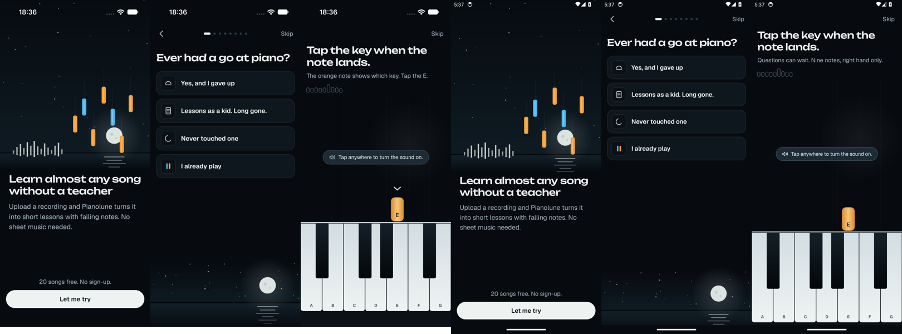

# Evidence: Android and iOS from one agent, two hosts — 2026-11-07

Stage 4 of [docs/hosting-plan.md](../../hosting-plan.md): one agent (a Linux VPS) connected to a Google
Cloud N2 VM for Android and a rented Scaleway Mac mini for iOS at the same time, through several
**connect targets** ([guide](../../guides/android-and-ios.md)). Real hosts; a Claude Code session ran the scripted CLI and MCP drivers (the MCP client was
`scripts/field-test/mcp-checklist.mjs` over stdio, not Claude Code itself), with the owner approving logins and pairings. Every checklist passed except the first iOS command of
one MCP run (a cold-runner timeout, [#137](https://github.com/mirzemehdi/tapdance/issues/137)); one
session leased Android and iOS in turn through the CLI and MCP, `doctor` and `devices` showed both
hosts, and with the Mac down the agent got a fast, named error while Android kept working.

## Environment

| | |
| --- | --- |
| Agent's machine | Linux VPS (Ubuntu, 8 GB, no KVM, no Xcode), in the owner's tailnet; Tapdance branch `stage-4/multi-target-connect` at `c0de4c1`, built from source (`packages/cli/dist/main.js`), Node.js 22.22.2, pnpm through a corepack shim |
| Scratch | `TAPDANCE_HOME` in a scratch folder on the VPS (its own `~/.tapdance` untouched); session ids `stage4-cli-tn`, `stage4-mcp-tn`, `stage4-cli-down-tn`, `stage4-mcp-down-tn` (tailnet runs), `stage4-cli`, `stage4-mcp`, `stage4-cli-apk`, `stage4-tap`, `stage4-cli-down`, `stage4-mcp-down`, `stage4-pianolune` (earlier runs) |
| Android host `n2` | Google Cloud VM `tapdance-n2`, **n2-standard-4** (4 vCPU, 16 GB, nested KVM), 64 GB pd-balanced, zone **europe-west1-b**, project `tapdance-n2-s4-20261107-pij0`, Terraform `infrastructure/terraform/google-cloud-n2` in ephemeral mode (8 h run limit, then delete); RUNNING 16:30:44 UTC. `scripts/host-setup.sh` + `host up`, Tapdance main **4473043**, Simlock 0.5.0 with Tapdance's patch, emulator 37.2.13, Android 34 `google_apis` x86_64, Pixel 8, one warm spare (default) |
| iOS host `mac` | The owner's rented Scaleway Mac mini **M1-M** (Apple M1, **8 GB**), macOS **27.2**, Xcode **27.0**, iOS 27.0 runtime, iPhone 17; Tapdance main **4473043**, Simlock 0.5.0; cold leases only (`host warm android=0,ios=0`, as in stage 3) |
| Pairings | `n2`: label `field-agent` (guard client `gt_b54932e410c3`, token fingerprint `94b0a9`); `mac`: label `stage4-agent` (`gt_1969a82e7457`, fingerprint `f14618`). Tokens copied with `scp` into the scratch folder (mode 600), never printed |
| Network | Tailscale, guards behind `tailscale serve` (TLS) on port 4720. The Mac's leg first ran over an SSH tunnel (below), then over the tailnet |
| Host-side window | 16:54-17:55 UTC |

## Design and owner decisions

The research and design note compared (1) a Simlock gateway pool, (2) several connect targets in the
client, routing by platform, and (3) both. The owner chose:

1. **Design 3, gateway run optional**: build design 2 (several connect targets, per-origin tokens, routing
   by platform, `--target`, per-host `doctor`/`devices`) plus the gateway `doctor` fix (an agent token
   reads each worker's capabilities from the gateway's `/v1/status`). Each host stays in device-only
   mode with its own guard and token, so every guard-only feature (uploads, host builds, `--from-ci`,
   timed touches, console, crashes) stays available and one leaked token reaches one host.
2. **One lease per session**, as before: Android, release, then iOS in one session; a phone and an
   iPhone at the same time take two sessions.
3. **No gateway-pool run** in this stage: gateway mode across machines (STATUS Q-06) stays unproven.
4. Mac: reuse the owner's existing M1-M rental (no new charge); N2: rent for the proof window only.

## What ran

### Setup

1. `connect https://<n2>.<tailnet>.ts.net:4720 --name n2 < <token file>` — PASS, fingerprint `94b0a9` as
   `host up` showed.
2. The Mac was **not in the tailnet** at first (tailscaled "Unable to connect to the coordination
   server"; a `tailscale down`/`up` as operator asked for a new login). Workaround: an SSH forward
   VPS `127.0.0.1:14720` → Mac `127.0.0.1:4720`, and `connect http://127.0.0.1:14720 --name mac` — PASS
   (fingerprint `f14618`). The runs in "Tunnel runs" below used it.
3. After the owner logged the Mac into Tailscale again (17:45): `disconnect mac`, then
   `connect https://<mac>.<tailnet>.ts.net:4720 --name mac` — PASS. Re-pointing needed `disconnect` first
   (`connect` refused: `USAGE` "Another target is already called mac"); fixed on this branch, see
   "Fixes from this run". The tunnel was closed at 17:45.
4. `connect --list`:

   ```text
   NAME  ENDPOINT                                PLATFORMS  TOKEN
   n2    https://<n2>.<tailnet>.ts.net:4720      any        saved (94b0a9)
   mac   https://<mac>.<tailnet>.ts.net:4720     any        saved (f14618)
   ```

5. `doctor --no-host` — PASS, exit 0, "All checks passed", `Connect targets — n2: Android; mac: iOS.
   Leases: Android → n2, iOS → mac`, one section per target (healthz 85-86 ms each, role agent, labels
   `field-agent` / `stage4-agent`, iOS skipped on `n2` "it runs Linux", Android skipped on `mac` "Android
   leases go to n2").
6. `devices` — PASS, one section per host. Cosmetic: each host also shows a capacity line for the
   platform it cannot run ("ios: 0/2 running" on `n2`), [#138](https://github.com/mirzemehdi/tapdance/issues/138).

### Tailnet runs (authoritative, 17:45-17:55 UTC)

Drivers in `scripts/field-test/`, one session per run, Android first, then iOS in the same session.

| Run (session) | Result | Android lease (`n2`) | iOS lease (`mac`, TLS) | First command after lease, Android / iOS |
| --- | --- | --- | --- | --- |
| CLI `two-hosts`, routing by platform only (`stage4-cli-tn`) 17:45:37-17:50:08 | **PASS** 21/21, 4 skipped | 10.6 s | 127.9 s (cold boot) | 0.54 s / 36.0 s |
| MCP `mcp-two-hosts.json`, `target` n2 / mac (`stage4-mcp-tn`) to 17:54:00 | **18/19**, 4 skipped; FAIL `key_home_ios` | 10.0 s | 86.0 s | 0.09 s / 45.7 s (FAIL) |
| CLI `host-down`, Mac guard stopped 17:54:25 (`stage4-cli-down-tn`) | **PASS** 7/7 | 10.4 s | `PROVIDER_UNREACHABLE` in 0.79 s | – |
| MCP `mcp-host-down.json` (`stage4-mcp-down-tn`) | **PASS** 6/6 | 24.1 s | `PROVIDER_UNREACHABLE` in 0.13 s | – |

Skipped steps need an app (`APK`, `APP`, app ids) that these runs did not set; the APK and app runs are
below. Other steps that passed in both sessions: status, `second_lease_refused` (an iOS lease while the
Android one is held: `LEASE_ALREADY_HELD` in 0.54 s CLI / 28 ms MCP), key home, inspect, swipe,
screenshot, logs, release, artifacts.

- **FAIL `key_home_ios` (MCP)**: the first iOS command after the cold lease returned `DEVICE_ERROR`
  "press home failed: Runner command deadline exceeded", `retryable: false`, after 45.7 s. Every later
  iOS step in that lease passed. The CLI run hit the same cold-runner slowness, retried ("The host's
  device daemon did not answer; trying again") and passed in 36 s. Host-side and not specific to two
  hosts (the same first-command delay as stage 3), but the error should be retryable:
  [#137](https://github.com/mirzemehdi/tapdance/issues/137).

### Tunnel runs (16:56-17:38 UTC, Mac over the SSH tunnel; also passed)

| Run (session) | Result | Android lease | iOS lease | First command A / iOS |
| --- | --- | --- | --- | --- |
| CLI `two-hosts` (`stage4-cli`) | **PASS** 21/21, 4 skipped | 12.9 s (warm) | 96.2 s (cold) | 0.67 s / 43.9 s |
| MCP `mcp-two-hosts.json` (`stage4-mcp`) | **PASS** 19/19, 4 skipped | 10.0 s | 73.3 s | 0.09 s / 70.8 s |
| CLI `two-hosts` + APK, with `--target` (`stage4-cli-apk`) | **PASS** 23/23, 2 skipped; APK install 3.3 s, launch 12.5 s | 18.7 s | 90.8 s | 0.65 s / 102 s |
| Tap probe (`stage4-tap`), 3 coordinate taps per lease | **PASS** | 10.4 s | 79.1 s | 0.62 s / 89.1 s |
| CLI `host-down` (`stage4-cli-down`) | **PASS** 7/7 | 10.4 s | `PROVIDER_UNREACHABLE` in 0.6 s | – |
| MCP `mcp-host-down.json` (`stage4-mcp-down`) | **PASS** 6/6 | 20.1 s | `PROVIDER_UNREACHABLE` in 0.19 s | – |
| Pianolune, one session, both hosts (`stage4-pianolune`) | **PASS** 26/26 | 10.7 s | 84.6 s | see below |

Latencies: Android coordinate tap 2.8-3.0 s, tap by id with settle 4.8-5.7 s; iOS coordinate tap
7.3-8.2 s, by id 5.6 s; steady-state commands Android 0.5-2 s, iOS 0.6-6 s. After some warm-spare
leases the emulator was still busy (settle notice "guest CPU 96 %") and the first swipe took 9-14 s:
[#139](https://github.com/mirzemehdi/tapdance/issues/139).

### Provider proof

Every lease reply named its host (`Endpoint: https://<n2>.<tailnet>.ts.net:4720 (target n2) (TLS)` for
Android, the Mac's endpoint with `(target mac)` for iOS; MCP `location.endpoint` and `target`). Each
lease id's lines in the guards' audit logs (`~/.tapdance/worker/audit.log`) appear only on the expected
host, 0 on the other, 0 `deny`:

| Lease | Run | `mac` lines | `n2` lines |
| --- | --- | --- | --- |
| `f13107f7…` | tailnet CLI, Android | 0 | 21 |
| `addb2722…` | tailnet CLI, iOS | 12 | 0 |
| `bbcb2f63…` | tailnet MCP, Android | 0 | 21 |
| `f8a50b1f…` | tailnet MCP, iOS | 14 | 0 |
| `6f1e7b4d…`, `18e07c18…` | tailnet host-down, Android | 0 | 16 / 14 |
| `ac7810dc…` / `81bb28cb…` | tunnel CLI, Android / iOS | 0 / 12 | 19 / 0 |
| `2f84b506…` / `c4ac4861…` | tunnel MCP, Android / iOS | 0 / 12 | 21 / 0 |
| `6db63aff…` / `e5ea6ce1…` | tunnel CLI + APK (upload + install) / iOS | 0 / 13 | 32 / 0 |
| `a1a1f643…`, `78a6193e…`, `ba19097c…` | tunnel host-down, Android | 0 | 16 / 14 / 12 |
| `759b15a1…` / `17c756ff…` | Pianolune Android / iOS (incl. host build) | 0 / 28 | 41 / 0 |

The refused second lease (`LEASE_ALREADY_HELD`) left no line on the Mac: it never left the agent.

### Host down

- Method: only the Mac's guard was stopped (`launchctl bootout gui/501/dev.tapdance.guard`), back with
  `launchctl bootstrap gui/501 ~/Library/LaunchAgents/dev.tapdance.guard.plist` (healthz 200 in 4 s).
  `tapdance host pause` was not used: it also removes `tailscale serve`, and the Mac had just needed a
  Tailscale re-login. Tunnel run 17:21:53-17:24:10, tailnet run 17:54:25-17:55:12.
- Tailnet: `tailscale serve` still answered, so the iOS lease failed with `PROVIDER_UNREACHABLE`
  (retryable) "Cannot lease ios: target mac (https://<mac>.<tailnet>.ts.net:4720) does not answer
  (…/v1/healthz answered HTTP 502)", hint "Up: n2 (android). Retry when mac is back …", details
  `{platform: ios, target: mac, down: [mac], up: [n2]}`. No other platform was leased instead.
- `doctor --no-host`: exit 0 in 0.9 s, "OK with 3 warning(s)", `! Connect targets — n2: Android; mac:
  down. Leases: Android → n2, iOS → no host up`, `! Target mac — … down (…answered HTTP 502)`, `n2` all ✓.
  The Mac's audit log has no line between 17:54:25 and 17:55:12.
- Over the tunnel: ECONNRESET with the guard stopped (0.6 s), ECONNREFUSED with the tunnel gone (0.63 s).
  A hung host (a TCP listener that never answers): lease `PROVIDER_UNREACHABLE` "aborted due to timeout"
  in 5.9 s, `devices` 5.4 s, an Android lease still 8.0 s, but `doctor` **30.4 s** (fixed on this branch,
  below).
- Mac back: `doctor` exit 0, "All checks passed", iOS → mac (17:55:15).

### Pianolune: one session, both hosts

Purpose: an agent builds, installs, launches and drives a real app on both hosts from one session (CLI,
Mac over the tunnel).

| Step | iOS on `mac` | Android on `n2` |
| --- | --- | --- |
| lease | 84.6 s (cold boot) | 10.7 s |
| get the app | `app build --git https://github.com/KAppMakerDeveloperApps/Pianolune-All --ref main --project MobileApp/iosApp/iosApp.xcodeproj --scheme iosApp`: 226 s, "Built Pianolune.app from 495ef95ec5be (main) in 216 s and installed it" (cached clone and DerivedData; Gradle 2 min 27 s) | `app install` of the CI debug APK (77 MB upload): 2.9 s |
| `app launch com.measify.pianolune` | 9.1 s | 9.5 s |
| first `ui inspect` (welcome) | 14.4 s | 1.4 s |
| `ui tap --id onb_welcome_cta` | 5.6 s ✓ | 5.7 s ✓ |
| `ui tap --id onb_skip` | 5.6 s ✓ | 4.8 s ✓ |
| inspect / screenshot | 0.6-0.7 s / 1.8-2.3 s | 0.6 s / 0.9-1.4 s |
| `logs --app`, release | 6.6 s, 1.8 s | 0.6 s, 1.4 s |

Both showed welcome "Learn almost any song without a teacher" → "Ever had a go at piano?" → (Skip) "Tap
the key when the note lands". iOS left, Android right:



### Unit-tested-only items (hosting-plan step 5)

| Item | Result |
| --- | --- |
| `host builds key --repo git@github.com:KAppMakerDeveloperApps/Pianolune-All.git` on the Mac | **PASS** (tool side): per-repository key created; printed the public key, fingerprint `SHA256:kyw8pLEyvMU4lq5w4pA/Iwd7k2e090sl58jCoq99JGY`, the deploy-key settings URL, read-only advice, the org-disabled fallback (`host gh-login`) and the `--remove` command. **Not added to GitHub** (owner step; the organization disables deploy keys), so no build used it. Removed at teardown. |
| `host up --tailscale-ssh --skip-self-test --idle-stop off --yes` on N2 | **PASS** (tool side): kept the `field-agent` pairing (same fingerprint), left worker and guard as they were, `tailscale set --ssh` without sudo (operator set by `host-setup.sh`) → `RunSSH: true`, printed the policy / check-mode warning and the off command. An ssh login from the VPS then waited for the owner's check-mode approval in a browser (>25 s, not completed): connecting needs that approval. `n2` leases kept working. |
| iOS `app install --from-ci` | **BLOCKED**: Pianolune-All's CI uploads only `android-debug-apk` and test reports, no simulator `.app` ([#121](https://github.com/mirzemehdi/tapdance/issues/121)). Not attempted. |

## Fixes from this run (on this branch)

- `connect <endpoint> --name <existing>` now moves that target to the new endpoint (keeps its place and
  platforms; the old address's token is removed) instead of refusing; an endpoint that is already another
  target is still refused, with `tapdance disconnect` named for either one.
- `doctor` runs the 5 s lease probe first and reports a target that gives no HTTP answer as down at once,
  instead of waiting for its own two 15 s tries (30.4 s with a hung host). A host that answers with an
  error status still gets its full doctor. Unit-tested; not re-run on hosts (they were torn down).

## Results by requirement

| ID | Result | |
| --- | --- | --- |
| M-06 | PASS | Two connect targets, per-origin tokens, routing by platform and by `--target` / `target`, follow-ups on the lease's host (audit logs), fast named error for a down host, per-host `doctor` and `devices`. |
| Q-06 | PARTIAL | Two machines at once from one agent in device-only mode; the gateway pool across machines not run (owner's choice). |
| C-05 | PASS | `doctor` shows both hosts and which host each platform goes to; with one down it warns, exit 0. |
| H-13 | PARTIAL | `host builds key --repo` output on a real Mac; no build through the key. |
| W-07 | PARTIAL | `host up --tailscale-ssh` on a real Linux host; the ssh login needs the owner's browser approval. |
| F-05 (iOS) | BLOCKED | No simulator `.app` in the test app's CI. |

## Process findings and deviations

- **Owner secrets typed by the agent.** The runbooks say the owner types every password or token. In
  this run the owner sent the Mac's account password and Google sign-in codes in the chat for the agent to
  enter (the agent did not print or store them). It worked, but it is the deviation stage 3 already
  showed (#126, #127): a VPS-only setup has no second machine for the owner to type on. The runbooks
  need a way that keeps secrets out of the agent's chat (for example the owner's own Tailscale SSH or
  console session for those steps).
- **The Mac fell off the tailnet** between stage 3 and this run and needed an owner re-login; until then
  the Mac's leg ran over an SSH tunnel (loopback, no TLS). Routing, tokens and host-down behaviour were
  the same over both.
- **`host-setup.sh` first run on N2 failed** because the VM's boot-time `apt-get` held the apt lock; the
  second run passed. Runbook updated ([field-test-cloud-android.md](../field-test-cloud-android.md)).
- **Host down by `host pause`** was in the stage 4 driver notes; it also removes `tailscale serve`.
  [scripts/field-test/README.md](../../../scripts/field-test/README.md) now says to stop only the guard.
- **`scaleway-leftovers.sh` needs the owner's `scw` login**: from the VPS it exits 2 (no CLI, no
  credentials). Runbook updated ([field-test-rented-mac-ios.md](../field-test-rented-mac-ios.md)).

## Teardown and cost

- N2: the VM ran 16:30:44 → about 17:59:06 UTC (1.47 h). `terraform destroy` 17:58:05-17:59:57 UTC, 15
  resources removed; `infrastructure/scripts/gcp-leftovers.sh tapdance-n2-s4-20261107-pij0` exit 0. The
  project was then deleted at about 18:06 UTC (`DELETE_REQUESTED`, recoverable for 30 days).
- Mac: the owner's existing rental, reused. Before deletion: guard token `gt_1969a82e7457`
  (`stage4-agent`) revoked, the Pianolune deploy key removed (never added to GitHub), the VPS's ssh key
  removed from `authorized_keys` (the next ssh was refused). The owner deleted the Mac mini at about 18:04
  UTC. `scaleway-leftovers.sh` not run: no `scw` credentials on the VPS; to be run by the owner with his
  login.
- Tailscale: the owner removed the `tapdance-n2` machine in the admin console (about 18:05 UTC).
- VPS: `gcloud` auth revoked (accounts and application-default credentials, again after the project
  deletion), pairing token copies, scratch home and keys deleted.
- Left for the owner: the Scaleway leftovers check (`scaleway-leftovers.sh` with his `scw` login). The owner
  ran it afterwards.

COST: N2 about USD 0.30-0.33 (VM, disk and IP for 1.47 h; estimate, billing page not checked); Mac EUR 0
extra (existing rental). Total about USD 0.30-0.33.

## Artifacts

| File | Size | SHA-256 | Where |
| --- | --- | --- | --- |
| `2026-11-07-two-hosts-android-ios/pianolune-strip.png` (iOS welcome, question, play; Android the same) | 242155 | `2c9aa19c780f6a409b077af6762da380f7b595db8e4e36dafc719432e2a40226` | Committed |
| Drivers' outputs (`results.json`, `results.tsv`, per-step output, screenshots), `doctor`/`devices`/`connect` outputs, audit-log extracts, item 5 outputs | – | – | Kept locally on the VPS (scratch folder, `out/` and `out/tailnet/`) |

## Re-run

```bash
export TAPDANCE_HOME="$HOME/td-stage4-home"
node packages/cli/dist/main.js connect https://<n2>.<tailnet>.ts.net:4720 --name n2 < pairing-n2.token
node packages/cli/dist/main.js connect https://<mac>.<tailnet>.ts.net:4720 --name mac < pairing-mac.token
node packages/cli/dist/main.js doctor --no-host
TAPDANCE_SESSION_ID=stage4-cli scripts/field-test/cli-checklist.sh two-hosts out/cli-two-hosts
TAPDANCE_SESSION_ID=stage4-mcp node scripts/field-test/mcp-checklist.mjs scripts/field-test/checklists/mcp-two-hosts.json out/mcp-two-hosts \
  --param ANDROID_TARGET=n2 --param IOS_TARGET=mac
# on the Mac: launchctl bootout gui/$(id -u)/dev.tapdance.guard
TAPDANCE_SESSION_ID=stage4-cli-down scripts/field-test/cli-checklist.sh host-down out/cli-mac-down --param DOWN_PLATFORM=ios --param DOWN_TARGET=mac
TAPDANCE_SESSION_ID=stage4-mcp-down node scripts/field-test/mcp-checklist.mjs scripts/field-test/checklists/mcp-host-down.json out/mcp-mac-down \
  --param DOWN_PLATFORM=ios --param DOWN_TARGET=mac --param UP_PLATFORM=android
```

Setup and teardown: [field-test-cloud-android.md](../field-test-cloud-android.md),
[field-test-rented-mac-ios.md](../field-test-rented-mac-ios.md), and
[scripts/field-test/README.md](../../../scripts/field-test/README.md) "Two hosts".

## Not covered

- The Simlock gateway pool across two machines (STATUS Q-06), by the owner's choice.
- Two leases at once (a phone and an iPhone in parallel, two sessions); only one lease per session in turn.
- The two fixes above on real hosts; a re-run of the MCP first iOS command after #137.
- A build through a per-repository deploy key; a completed Tailscale SSH login; iOS `--from-ci`.
- Warm iOS spares (8 GB Mac); `connect --platform`.

## Issues filed

- [#137](https://github.com/mirzemehdi/tapdance/issues/137) iOS: "Runner command deadline exceeded" on the first command after a cold lease is `DEVICE_ERROR`, `retryable: false`.
- [#138](https://github.com/mirzemehdi/tapdance/issues/138) `devices` shows capacity for a platform the host cannot run.
- [#139](https://github.com/mirzemehdi/tapdance/issues/139) Android: a warm-spare lease is handed out busy, first swipe 9-14 s.
